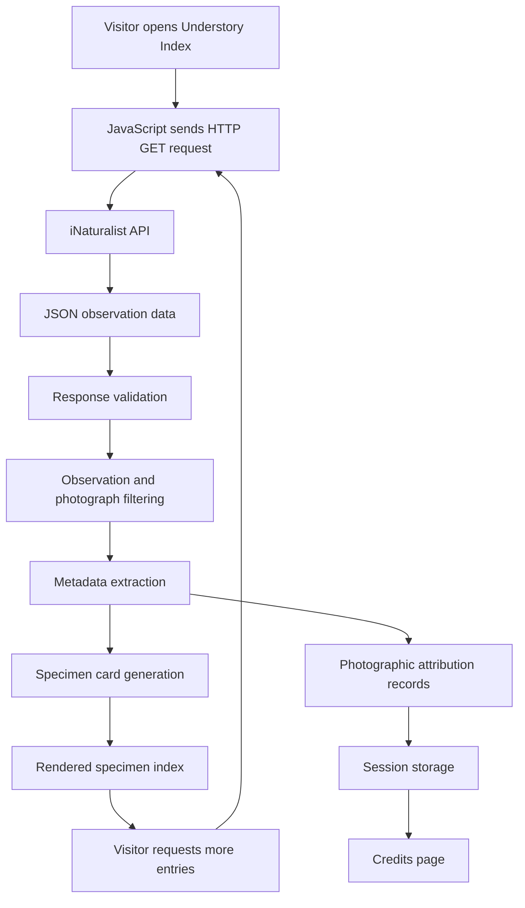

# Understory Index

*Exploring London's fungal biodiversity through experimental information design!*

[Discover for yourself here:](https://angel5wing.github.io/understory-index/)

## Overview

Understory Index is a digital field guide to London's boundless mycological magic, bringing together community observations, photographs & ecological records through the iNaturalist API.

Part field guide, part experiment in information design, the project explores how biodiversity data can be organised, interpreted & experienced beyond the conventions of a scientific database.

By transforming structured observational data into a visual archive of individual specimens, Understory Index invites visitors to discover some of the often-overlooked organisms living right alongside us! :D

The project also serves as a practical exploration of third-party API integration, asynchronous data retrieval, dynamic content generation, data accessibility & responsible use of community-contributed imagery. 

## Contents

- [Features](#features)
- [Technology stack](#technology-stack)
- [Project structure](#project-structure)
- [Application architecture](#application-architecture)
- [API integration](#api-integration)
- [Data processing](#data-processing)
- [Pagination and state management](#pagination-and-state-management)
- [Error handling and resilience](#error-handling-and-resilience)
- [Photographic attribution and licensing](#photographic-attribution-and-licensing)
- [Accessibility and responsive design](#accessibility-and-responsive-design)
- [Getting started](#getting-started)
- [Current limitations](#current-limitations)
- [Future development](#future-development)
- [Acknowledgements](#acknowledgements)

## Features

- Live retrieval of fungal observations through the iNaturalist API.
- Geographically filtered observations from the Greater London area.
- Dynamically generated specimen cards containing photographs, common names, scientific names, observation dates and locations.
- Incremental data retrieval through user-controlled pagination.
- Duplicate observation detection.
- Client-side photographic licence filtering.
- Individual links to original iNaturalist observation records.
- Dedicated photographic credits page.
- Session-based storage of photographic attribution records.
- Loading, empty-state and error feedback.
- Retry functionality for unsuccessful API requests.
- Responsive layouts across desktop and mobile devices.

## Technology stack

| Technology | Purpose |
| --- | --- |
| HTML5 | Semantic document structure |
| CSS3 | Visual identity, responsive layouts and interface styling |
| JavaScript (ES6+) | Application logic, data processing and DOM manipulation |
| Fetch API | Asynchronous HTTP requests |
| Web Storage API | Session-based photographic attribution storage |
| iNaturalist API | Biodiversity observations and photographic metadata |
| Git and GitHub | Version control and source code management |
| GitHub Pages | Static website hosting and deployment |

Understory Index is built using vanilla JavaScript, without external frameworks, package dependencies or a dedicated backend.

## Project structure

```text
understory-index/
├── index.html       # Main specimen index
├── about.html       # Project context and future development
├── credits.html     # Photographic attribution
├── style.css        # Shared visual styling
├── script.js        # API integration and specimen rendering
├── credits.js       # Attribution retrieval and rendering
└── README.md        # Project documentation
```

## Application architecture

Understory Index operates as a client-side web application.

The browser communicates directly with the iNaturalist API, processes the returned JSON data and dynamically generates the interface. No intermediary server or local database is required.



The application separates its responsibilities across two primary JavaScript files:

- `script.js` manages observation retrieval, filtering, pagination, specimen rendering and attribution collection.
- `credits.js` retrieves and presents photographic attribution, either from the current browsing session or through an independent API request.

This separation allows the index and credits page to operate independently while sharing attribution data when available.

## API integration

### Data provider

Understory Index retrieves community-contributed biodiversity observations from [iNaturalist](https://www.inaturalist.org/), a platform connecting naturalists, researchers and members of the public through the documentation of biodiversity.

### Endpoint

The current implementation uses the iNaturalist observations JSON endpoint:

```http
GET https://www.inaturalist.org/observations.json
```

The endpoint returns observation records containing associated taxonomic information, photographic metadata, observation dates and geographical descriptions.

The application uses a publicly accessible endpoint and does not require API credentials or user authentication.

### Query parameters

API requests are configured using the following parameters:

| Parameter | Value | Purpose |
| --- | --- | --- |
| `taxon_id` | `47170` | Restricts observations to the kingdom Fungi |
| `place_id` | `66357` | Restricts observations to the selected Greater London place |
| `per_page` | `20` | Requests up to 20 observations per page |
| `order_by` | `date_added` | Sorts observations by their addition to iNaturalist |
| `order` | `desc` | Returns more recently added observations first |
| `photo_license` | `cc0,cc-by` | Filters observations by photographic licence |
| `page` | Dynamic integer | Determines which page of results is requested |

Sorting by `date_added` refers to when an observation was added to iNaturalist, rather than necessarily when the organism was observed.

### Example request

The following request retrieves the first page of fungal observations matching the application's geographical and photographic licence filters:

```http
GET https://www.inaturalist.org/observations.json?taxon_id=47170&place_id=66357&per_page=20&order_by=date_added&order=desc&photo_license=cc0,cc-by&page=1
```

The same request can be reproduced directly in a browser or through a command-line HTTP client:

```bash
curl "https://www.inaturalist.org/observations.json?taxon_id=47170&place_id=66357&per_page=20&order_by=date_added&order=desc&photo_license=cc0,cc-by&page=1"
```

### Asynchronous retrieval

Requests are performed using the browser's Fetch API and JavaScript's `async`/`await` syntax.

```javascript
const response = await fetch(
  `${API_URL}&page=${currentPage}`
);

if (!response.ok) {
  throw new Error(`HTTP error: ${response.status}`);
}

const observations = await response.json();

if (!Array.isArray(observations)) {
  throw new Error("unexpected API response format");
}
```

Before processing observation records, the application:

1. Sends an asynchronous HTTP GET request.
2. Checks whether the HTTP response indicates success.
3. Parses the response body as JSON.
4. Validates that the parsed response is an array.
5. Processes eligible observation records.

This validation is important because a completed HTTP request does not necessarily indicate a successful response, and successfully parsed JSON does not necessarily conform to the expected data structure.

## Data processing

The API response contains substantially more information than is required by the interface.

Understory Index extracts relevant fields and transforms them into a consistent specimen card structure.

### Response field mapping

| API response field | Application use |
| --- | --- |
| `observation.id` | Unique observation identifier and source link |
| `observation.taxon.name` | Scientific name |
| `observation.taxon.common_name.name` | Preferred common name |
| `observation.species_guess` | Alternative display name |
| `observation.observed_on` | Observation date |
| `observation.place_guess` | Geographical description |
| `observation.photos` | Available observation photographs |
| `photo.large_url` | Displayed specimen photograph |
| `photo.license_code` | Photographic licence validation |
| `photo.license_url` | Link to licence information, when available |
| `photo.attribution` | Photographic attribution metadata |
| `observation.user.login` | Fallback attribution identifier |

### Observation filtering

Not every observation returned by the API is suitable for display.

Before generating a specimen card, the application checks that:

- The observation contains an identifier.
- The observation has not already been displayed.
- At least one associated photograph has an approved licence.
- The selected photograph contains a usable large-image URL.

Records that do not satisfy these conditions are skipped.

The application therefore distinguishes between the number of observations returned by the API and the number of eligible specimens actually displayed.

### Handling incomplete records

Community-contributed biodiversity records can vary in completeness.

Optional chaining and fallback values are used to prevent missing metadata from interrupting the rendering process.

For example:

```javascript
const scientificName =
  observation.taxon?.name || "unidentified";

const commonName =
  observation.taxon?.common_name?.name ||
  observation.species_guess ||
  scientificName;

const date =
  observation.observed_on || "unknown";

const location =
  observation.place_guess || "greater london";
```

Rather than requiring every record to contain identical fields, the application establishes a hierarchy of alternative values.

An observation without a common name can therefore still be displayed using its community-provided identification or scientific name.

### Dynamic content generation

Each eligible observation is transformed into a specimen card using JavaScript DOM methods, including:

- `document.createElement()`
- `appendChild()`
- `append()`
- `textContent`

Each card contains a sequential specimen number, photograph, identification information, observation metadata and a link to the original iNaturalist record.

Externally supplied textual metadata is inserted using `textContent` rather than interpreted as HTML.

This approach maintains a separation between external data and document markup while reducing the risk of unintended HTML injection through observation metadata.

## Pagination and state management

Rather than requesting a large collection of observations simultaneously, Understory Index retrieves results incrementally in batches of up to 20 records.

Visitors can request additional observations through the "view more entries" button.

The application maintains the following state:

| Variable | Purpose |
| --- | --- |
| `currentPage` | Tracks the next API results page |
| `totalLoaded` | Tracks the number of displayed specimens |
| `isLoading` | Indicates whether a request is in progress |
| `hasMore` | Indicates whether another results page may be available |
| `displayedObservations` | Stores identifiers of previously displayed observations |
| `photoCredits` | Collects attribution records for displayed photographs |

### Request lifecycle

When a visitor requests another page:

1. The application checks whether a request is already in progress.
2. The pagination button is temporarily disabled and hidden.
3. The next page of observation data is requested.
4. Eligible observations are filtered and appended to the existing index.
5. Photographic attribution records are updated.
6. The page counter advances.
7. The interface updates its displayed specimen count.
8. Pagination controls are restored when appropriate.

The `isLoading` flag prevents overlapping requests initiated through the pagination interface.

### Duplicate detection

Observation identifiers are stored in a JavaScript `Set`:

```javascript
const displayedObservations = new Set();
```

Before an observation is rendered, its identifier is checked against this collection.

```javascript
if (
  observation.id == null ||
  displayedObservations.has(observation.id)
) {
  return;
}
```

This prevents previously displayed observations from generating duplicate specimen cards during the current index session.

### Pagination termination

The application determines whether additional results may be available by comparing the number of returned observations with the requested page size.

```javascript
currentPage += 1;
hasMore = observations.length === PAGE_SIZE;
```

A response containing fewer than 20 observations is treated as the final results page.

Importantly, this calculation uses the number of observations returned by the API rather than the number of specimen cards generated after client-side filtering.

This prevents a partially filtered batch from prematurely terminating pagination.

## Error handling and resilience

Because Understory Index depends on an external data provider, unsuccessful requests and incomplete records are treated as expected possibilities.

The application uses `try`, `catch` and `finally` blocks to manage asynchronous request failures and restore interface state.

### Handled scenarios

| Scenario | Application behaviour |
| --- | --- |
| Network request failure | Displays connection feedback and offers a retry |
| Unsuccessful HTTP response | Throws an error containing the HTTP status code |
| Unexpected response structure | Rejects a response that is not an array |
| Missing observation identifier | Skips the affected record |
| Missing taxonomic metadata | Uses alternative display values |
| Missing observation date or location | Displays fallback metadata |
| Missing eligible photograph | Skips the affected record |
| Repeated observation identifier | Prevents duplicate rendering |
| Empty eligible results | Displays contextual empty-state feedback |
| Session storage failure | Logs the issue without intentionally interrupting the index |
| Credits retrieval failure | Displays an explanatory error message |

### Retry behaviour

The page counter advances only after a batch has been successfully processed and its attribution records have been saved or attempted.

If an API request fails, the current page remains available for another attempt.

Previously displayed specimens remain in the interface, allowing visitors to retry without restarting their exploration.

The `finally` block restores the loading state regardless of whether the request succeeds or fails.

### User-facing feedback

Technical errors are logged to the browser console, while the interface presents accessible, contextual messages consistent with the project's visual and narrative identity.

Examples include:

- "connecting to wood wide web..."
- "tracing mycelial network..."
- "the network was interrupted. try again..."
- "no eligible fungal photographs found..."

This separates developer-facing diagnostic information from visitor-facing communication.

## Photographic attribution and licensing

Understory Index relies on photographs contributed by the iNaturalist community.

Respecting the ownership and licensing conditions of these photographs is a core consideration of the implementation.

### Licence filtering

The application requests observations associated with the following photographic licences:

- [CC0](https://creativecommons.org/publicdomain/zero/1.0/)
- [CC BY](https://creativecommons.org/licenses/by/4.0/)

Licence eligibility is also checked on the client side.

```javascript
const ALLOWED_LICENSES = new Set([
  "CC0",
  "CC-BY"
]);
```

The application selects the first photograph associated with an observation that has an approved licence and a usable large-image URL.

This additional validation is necessary because an observation may contain multiple photographs with different licensing conditions.

Filtering observations at the API level does not remove the need to validate the individual photograph selected for display.

### Attribution records

When a specimen card is generated, the application also creates an associated attribution record containing:

- Sequential specimen number.
- Original observation identifier.
- Display name.
- Photographer or fallback attribution identifier.
- Original attribution metadata, when available.
- Photographic licence.
- Licence information URL.
- Original observation URL.
- Photograph URL.

Photographic attribution is presented through an overlay on specimen photographs and a dedicated credits page.

The original attribution metadata is retained in the index's session records, while the credits interface displays the extracted photographer name and associated source and licence links.

### Session-based attribution storage

Attribution records are collected as visitors explore the index and stored using the browser's `sessionStorage` API.

```javascript
sessionStorage.setItem(
  "understory-photo-credits",
  JSON.stringify(photoCredits)
);
```

The credits page retrieves these records and reconstructs the attribution list.

This allows the credits page to reflect the specimens loaded during the current browsing session without making an additional API request for every displayed observation.

A new index page load resets the stored attribution collection.

### Independent credits retrieval

If the credits page is accessed without available session records, it independently requests the first page of observations from iNaturalist.

It then applies the same photographic eligibility criteria and generates a corresponding attribution list.

This ensures that the credits page can still present relevant information when accessed independently.

However, this fallback represents a fresh API response rather than a persistent record of a previous index session.

### Image ownership

Understory Index does not claim ownership of the photographs displayed within the application.

Photographs remain subject to their respective creators' rights and applicable licensing conditions.

Where available, licence URLs supplied by the API are used directly. Otherwise, the application provides predefined Creative Commons licence links.

Visitors can follow the original observation and photograph links to consult the source material.

## Accessibility and responsive design

The interface is designed to remain usable across different screen sizes and interaction methods.

Accessibility and usability considerations include:

- Semantic HTML elements for navigation and specimen entries.
- Responsive specimen grid layouts.
- Alternative text for dynamically generated photographs.
- Keyboard-focusable photographic attribution overlays.
- Live status feedback for asynchronous data retrieval.
- Visible photographic attribution on touch-oriented layouts.
- Lazy loading of specimen photographs.
- Reduced-motion styling.
- External source links using `rel="noopener noreferrer"`.

The interface uses progressive data retrieval to avoid loading the entire available observation collection at once.

These measures represent initial accessibility considerations rather than a claim of comprehensive accessibility compliance.

## Getting started

Understory Index does not require a package manager, build process, API key or backend configuration.

### Prerequisites

- Git.
- A modern web browser.
- A local development server.
- An internet connection for retrieving observation data and photographs.

### 1. Clone the repository

```bash
git clone https://angel5wing.github.io/understory-index
```

### 2. Navigate to the project directory

```bash
cd understory-index
```

### 3. Start a local development server

The project can be opened using the Live Server extension in Visual Studio Code.

Alternatively, if Python 3 is installed, run:

```bash
python3 -m http.server 8000
```

Then navigate to:

```text
http://localhost:8000
```

The application will automatically request the first page of observations when the index loads.

### 4. Explore the application

- Open the index to retrieve fungal observations.
- Select "view more entries" to retrieve additional results.
- Follow specimen links to explore original iNaturalist records.
- Navigate to the credits page to inspect photographic attribution.
- Visit the about page to learn more about the project's conceptual motivation.

### Configuration

The primary API configuration is defined at the beginning of `script.js` and `credits.js`.

Developers can adapt the integration by modifying the taxonomic filter, geographical filter, page size or ordering parameters.

When modifying these settings, corresponding values should be updated consistently across both scripts.

In particular, `PAGE_SIZE` in `script.js` must remain consistent with the API's `per_page` parameter.

## Deployment

Understory Index is deployed as a static website using GitHub Pages.

The deployment serves the HTML, CSS and JavaScript files directly from the repository's `main` branch.

As API requests are performed within the browser, no additional server-side infrastructure is required.

[Visit the live deployment](https://angel5wing.github.io/understory-index)

## Current limitations

Understory Index is an initial implementation focused on establishing a functional and accessible foundation for biodiversity exploration.

The following limitations inform future development:

### External API dependency

The application depends on the availability, response structure and behaviour of the iNaturalist API.

Changes to the endpoint or its returned data could require corresponding updates to the integration.

The current implementation uses the observations JSON endpoint rather than the newer versioned iNaturalist API.

### Dynamic observation data

The underlying observation collection changes as new records are added and existing records are updated.

Because pagination operates over a changing dataset, observations may shift between results pages during an active session.

Duplicate detection prevents repeated display but does not guarantee that every matching observation will be retrieved.

### Observation identification

The application presents community-contributed identifications and does not independently verify taxonomic accuracy.

Observations are not restricted to research-grade records.

Understory Index is intended for exploratory and educational use, rather than definitive species identification or foraging guidance.

### Geographical and temporal coverage

The index reflects observations contributed to iNaturalist within the selected geographical area.

It should not be interpreted as a comprehensive inventory of London's fungal biodiversity.

Observation frequency may reflect patterns of human activity, accessibility, seasonal variation and community participation.

### Session-based credits

Photographic attribution records are stored within the current browser session rather than a persistent database.

Reloading the index resets the attribution collection, and independently accessing the credits page may produce a different set of records.

### Attribution metadata

Photographer identification depends on the metadata supplied by iNaturalist.

When an explicit photographer name cannot be extracted, the application falls back to the observation contributor's username or an unknown-photographer label.

The observation contributor is not necessarily the original photographer.

More comprehensive attribution parsing and licence-version validation would strengthen the current implementation.

### Shared configuration

API configuration and photographic filtering logic are currently maintained separately in `script.js` and `credits.js`.

Extracting these shared responsibilities into reusable JavaScript modules would improve maintainability and reduce duplication as the application grows.

## Future development

Understory Index currently presents fungal observations as individual records, but fungi rarely exist in isolation.

The longer-term aim is to explore how biodiversity interfaces might communicate ecological relationships rather than exclusively cataloguing individual organisms.

### The visible world

The current implementation establishes the first mode of exploration: the visible world.

This mode focuses on observable organisms and their associated photographs, identifications, dates and geographical descriptions.

It provides a familiar field-guide structure through which visitors can begin exploring local fungal biodiversity.

### The relational world

Future development will explore a second mode of discovery: the relational world.

Rather than treating each observation as an isolated entry, this mode would investigate relationships between fungi and the wider ecological systems in which they exist.

Potential areas of exploration include:

- Associated plant species.
- Habitat characteristics.
- Growth substrates.
- Environmental conditions.
- Ecological roles.
- Processes of decomposition.
- Mycorrhizal and other symbiotic relationships.

Developing this mode would involve evaluating additional biodiversity and environmental data sources, investigating compatible taxonomic identifiers and determining how relationships could be represented responsibly.

Importantly, geographical proximity or shared environmental conditions would not necessarily establish a direct ecological relationship between individual organisms.

The challenge is therefore not only one of technical integration, but also one of interpretation and information design.

### Technical development

Potential technical improvements include:

- Evaluating migration to the versioned iNaturalist API.
- Extracting reusable API and attribution modules.
- Introducing more comprehensive response validation.
- Improving photographic attribution and licence-version handling.
- Implementing request timeouts and rate-limit-aware retry behaviour.
- Introducing automated tests for data processing and pagination.
- Expanding accessibility testing.
- Exploring additional biodiversity and environmental API integrations.
- Developing interfaces for relational ecological exploration.

The aim is to move beyond cataloguing individual organisms towards an interface that makes ecological interdependence more visible, transforming the index from a collection of observations into an interconnected, living archive.

## Acknowledgements

Understory Index is made possible by the iNaturalist community and the wonderful individuals who contribute their observations, photographs, identifications & ecological knowledge.

- [iNaturalist](https://www.inaturalist.org/)
- [iNaturalist API documentation](https://api.inaturalist.org/v1/docs/)
- [Creative Commons](https://creativecommons.org/)
- [GitHub Pages](https://pages.github.com/)

Above all, this project is dedicated to the often-overlooked fungal communities that transform & regenerate nearly all ecological processes across our shared planet ⋆˙ ⟡ ♡